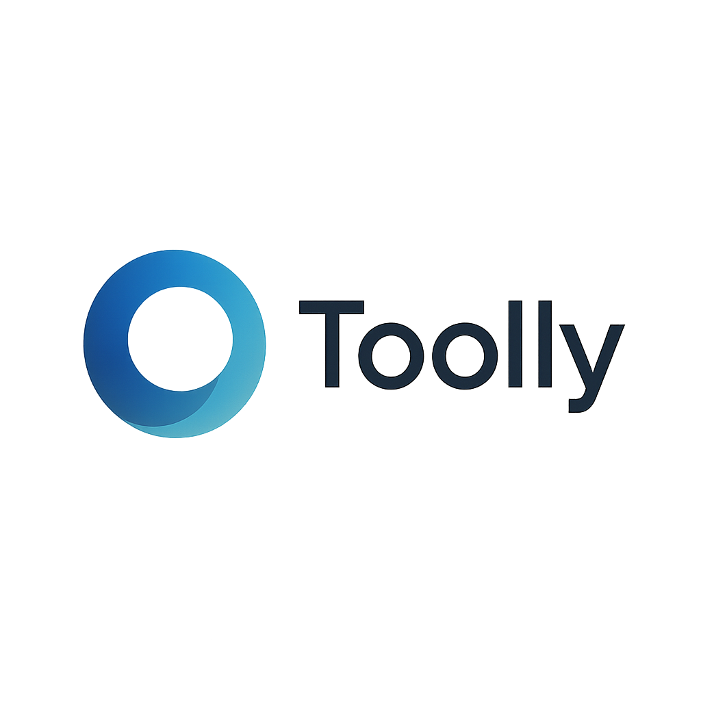

# **Toolly**


<div align="center">

  [](https://opensource.org/licenses/MIT)
  [](https://github.com/AdilShamim8/Toolly/issues)
  [](https://github.com/AdilShamim8/Toolly/stargazers)

  *"The tools you need to build the future, all in one place."*
</div>

**Toolly** is a free, curated AI tools directory. It helps you discover, compare, and shortlist 560+ AI tools across 15 categories — chatbots, coding assistants, image and video generators, audio, productivity, research, and more — in one clean, fast, privacy-friendly page with no signup.

Live site: <https://adilshamim8.github.io/Toolly/>

## What Makes Toolly Special

* **Curated, not scraped**: every entry is hand-checked for a working product URL, a real description, pricing badges, and category tagging.
* **Fast and clean**: a single static page — no frameworks, no tracking bloat, quick to load even on mobile networks.
* **Organized by intent**: quick category pills, sidebar filters with live tool counts, pricing filter, and sort by Trending / Newly Added / Featured.
* **Works offline-first in your browser**: search state, theme, and your personal shortcuts persist locally — nothing is stored on a server.
* **Open by design**: MIT licensed; contributions and corrections are welcome.

## Core Features

1. **560+ curated AI tools** across 15 categories, each with logo, description, pricing badge, and tags.
2. **Instant search with autocomplete**: ranked suggestions with logos and pricing as you type, full keyboard navigation (Arrow keys + Enter).
3. **Tool detail pages** (modal): full description, categories, tags, Visit Site CTA, and a *Similar Tools* recommendation row computed from shared categories and tags.
4. **Discovery strip**: Trending, Hot Today (rotates daily), and Newly Added lists in ranked chip form.
5. **Sponsored placements**: transparent pay-more-rank-higher advertising — top 3 sponsors appear above the directory with rank badges and tier labels (Platinum/Gold/Silver/Bronze). Managed in `sponsors.js`; see the "Advertise on Toolly" section on the site.
6. **Pricing filter**: Free / Freemium / Paid / Open Source, combinable with search, categories, and sort.
7. **My Tools**: save personal shortcuts in localStorage, with drag-to-reorder, logo auto-fetch, and duplicate-URL warnings.
8. **Dark mode, responsive layout, and accessibility**: keyboard reachable controls, ARIA state on filters and dialogs, visible focus rings, reduced-motion support.

## Repository Layout

```
index.html        Landing page: hero search, task finder, categories, journey, trending, FAQ
tools.html        Full directory: filters, sponsored, discovery, My Tools, advertise, submit
about.html        About page
learn-ai.html     Learn AI: step-by-step beginner roadmap (4 stages, 10 lessons)
privacy.html      Privacy policy
terms.html        Terms of service
tools-data.js     Shared tool dataset (window.TOOLLY_TOOLS, 561 entries)
scripts.js        Directory rendering and filters
landing.js        Landing page logic (search, task finder, category grid, legacy redirect)
sponsors.js       Sponsored placements (pay more, rank higher)
tool-details.js   Tool detail modal + Similar Tools engine
search-suggest.js Search autocomplete
styles.css        Full design system (Toolly green, light + dark)
legal-pages.js    Shared logic for secondary pages (sidebar, theme, back-to-top)
logo/             Brand assets
```

The old directory URLs (`/?q=...`, `/index.html?cat=...`) are forwarded to
`tools.html` with parameters intact by `landing.js`, so existing links keep
working.

## Quick Start

The site is fully static — serve it with any static file server:

```bash
git clone https://github.com/AdilShamim8/Toolly.git
cd Toolly
python3 -m http.server 8000
# open http://localhost:8000
```

No build step, no dependencies. Opening `index.html` directly also works.

### Adding a tool

Append an entry to the `aiTools` array in `scripts.js`:

```js
{
    "name": "Example AI",
    "description": "One clear sentence about what it does.",
    "categories": ["coding"],            // any of the 15 sidebar categories
    "logo": "https://icons.duckduckgo.com/ip3/example.com.ico",
    "url": "https://example.com",
    "badges": ["freemium"],              // free | freemium | paid | open source | featured | trending | new | popular
    "tags": ["keyword", "another-keyword"]
}
```

Badges drive the pricing filter and the Trending / Newly Added lists, so tag them accurately. New entries appear in the "Newly Added" discovery list automatically (newest first).

### Managing sponsor placements

Edit `sponsorPlacements` in `sponsors.js`. Each entry carries a `sponsor.monthlyBid` (USD/month); the list is sorted by bid, highest first. Rank 1–3 = Platinum, 4–6 = Gold, 7–9 = Silver, 10+ = Bronze. There is no payment processing yet — placements are sold directly and updated by editing the file.

## Use Cases

- **Creators and marketers**: find image, video, and copy tools, compare pricing at a glance.
- **Developers**: shortlist coding assistants and IDEs, then keep favorites one click away in My Tools.
- **Students and researchers**: research assistants, citation tools, and the Learn AI roadmap.
- **Teams evaluating AI**: the detail modal's Similar Tools row makes shortlists and comparisons quick.

## Contributing

1. Fork the repo
2. Create a feature branch
3. Open a Pull Request

Tool corrections (wrong pricing, dead links, better descriptions) are just as welcome as features.

## License

Released under the **MIT License**. See `LICENSE` for details.

---

<div align="center">
  <i>Designed and built with by <a href="https://adilshamim.me/">Adil Shamim</a></i>

  [Live](https://adilshamim8.github.io/Toolly/)
</div>
